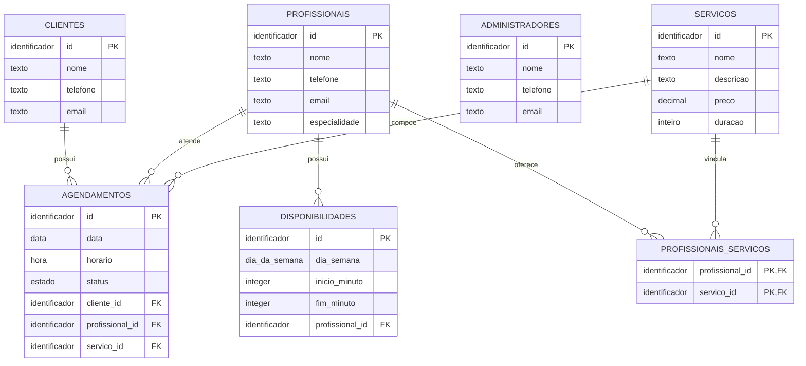

# Modelo PostgreSQL

Tipos SQL e nomes físicos exatos estão no schema Prisma. Tabela por classe concreta, FKs Restrict, relação N:N explícita e status enum. Veja [modelo](../database/modelo-dados.md).
